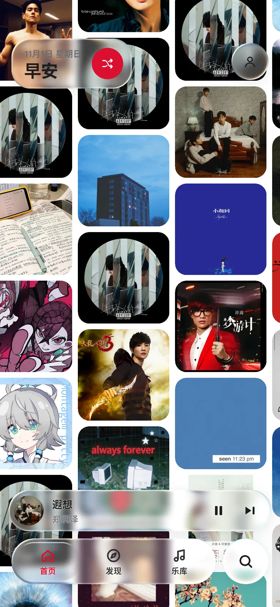
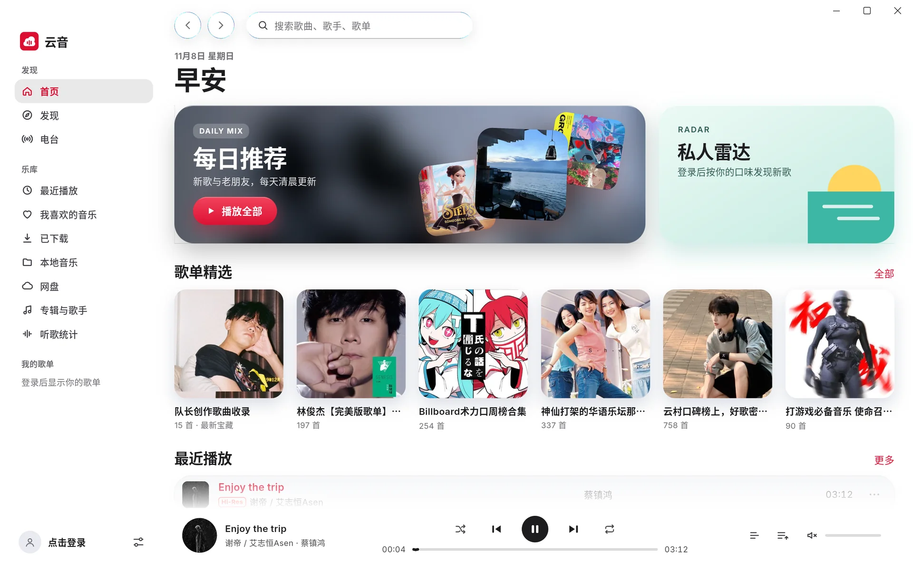
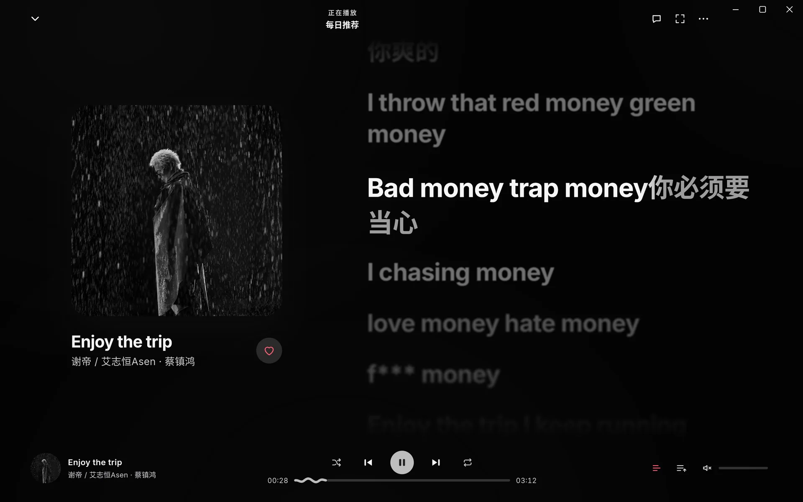

<div align="center">


# 云音 YunYin

**一款开源、跨平台的第三方音乐客户端**
网易云音乐 · QQ 音乐 · 酷狗音乐 · 洛雪曲库 · 本地音乐 · 网盘，一个应用全部搞定

[](https://github.com/Marginal-Z/YUNYIN/releases/latest)
[](https://github.com/Marginal-Z/YUNYIN/actions/workflows/build.yml)
[](https://github.com/Marginal-Z/YUNYIN/releases)


[官网](https://marginal-z.github.io/YUNYIN/) · [下载](https://github.com/Marginal-Z/YUNYIN/releases/latest) · [更新日志](CHANGELOG.md) · [问题反馈](https://github.com/Marginal-Z/YUNYIN/issues)

</div>

---

## 截图

**平台模式**

| 网易云音乐 | QQ 音乐 | 酷狗音乐 | 照片墙首页 |
| :---: | :---: | :---: | :---: |
|  |  |  |  |

**播放样式与歌词**

| 封面 | 黑胶 | 3D 封面流 | 歌词 |
| :---: | :---: | :---: | :---: |
|  |  |  |  |

**桌面端**

| 首页 | 正在播放 |
| :---: | :---: |
|  |  |

> 截图均为应用的真实渲染画面（桌面端截图模式 `YUNYIN_SHOTS` 自动生成；黑胶样式为播放页组件按手机尺寸渲染，歌曲与歌词为示例内容）。

## 特性

**四种平台模式，各自独立**
- 网易云音乐、QQ 音乐、酷狗音乐与洛雪曲库四种平台模式，切换平台时首页、发现、搜索、排行榜、乐库、账号、播放队列与界面样式一起切换，每个平台记住自己的主题色与播放样式
- 三个平台只播放各自官方接口的歌曲，互不兜底；未登录或没有会员时，会员歌曲只播放平台提供的试听片段，不绕过平台的权限限制
- 网易云：验证码 / 扫码 / 密码登录，每日推荐、私人雷达、歌单、专辑、歌手、电台、评论
- QQ 音乐：QQ / TIM 扫码登录，按所选音质播放（Hi-Res / 无损 / 320k）；乐库同步我喜欢、自建与收藏的歌单、收藏的专辑与关注的歌手，显示绿钻 / 豪华绿钻等级与到期日
- 酷狗音乐：应用内官方登录页或 Cookie 登录；乐库同步我喜欢、歌单、收藏的专辑与关注的歌手，显示畅听 / 豪华 VIP 与到期日
- 三个平台都有歌单、专辑、歌手、排行榜、评论与完整搜索
- 每个平台的全部排行榜按原平台分组（如 QQ 音乐巅峰榜 / 地区榜 / 全球榜、酷狗 56 个榜单），歌单广场按平台自己的分类浏览并分页加载
- 个人中心显示当前平台的会员名称、等级、到期时间与权益
- 洛雪曲库：与洛雪音乐相同，曲库来自所选平台的公开接口，播放只通过导入的洛雪音源脚本（可同时启用多个，按顺序尝试）；按启用的音源支持的平台切换酷我、酷狗、QQ 音乐或网易云曲库，并实时检测每个音源是否可用

**播放与歌词**
- 八种播放样式：封面、黑胶、光盘、沉浸、卡片流、3D 封面流、照片墙、极简；竖屏、横屏与桌面端都可使用
- Apple Music 风格歌词：逐行弹簧滚动、逐字填色、翻译、拖动浏览；横屏播放页沉浸显示
- 桌面歌词（Android 悬浮窗 / 桌面端独立的置顶歌词窗口，可拖动、可锁定鼠标穿透，自定义颜色与透明度）与 Android 状态栏歌词
- 10 段均衡器与预设、音量均衡与强度调节、音量增强；Android 高解析输出、Windows / macOS 独占输出
- 基于 libmpv（FFmpeg）的播放引擎，支持 FLAC / APE / DSD 等格式，淡入淡出、睡眠定时

**本地音乐与网盘**
- 扫描或导入本地音乐，后台解析标签，几千首歌也流畅；封面与歌词依次在三个平台中联网匹配，也可手动选择
- 正确识别 GBK / UTF-16 编码的歌词与标签，支持同目录 `cover.jpg`
- WebDAV 网盘挂载：坚果云、Nextcloud、群晖、pCloud 等直接添加；阿里云盘、百度网盘、夸克、115、OneDrive、Google Drive 等经 Alist / OpenList 挂载

**界面与体验**
- 液态玻璃导航与控件、浅色 / 深色 / 跟随系统、五种主题色、封面取色背景、自定义背景图
- 手机与平板使用移动布局，电脑使用桌面布局；横屏时为类似车机的极简布局（左侧导航、底部播放条，首页按屏幕整体缩放）；无限照片墙首页
- Android 桌面小组件、应用图标跟随主题色；桌面端快捷键、迷你模式、Windows 风格窗口按钮
- 应用内一键更新；无广告、无统计、不收集任何个人数据

## 下载安装

前往 [Releases](https://github.com/Marginal-Z/YUNYIN/releases/latest) 下载对应平台的安装包：

| 平台 | 文件 | 说明 |
| --- | --- | --- |
| Android | `YunYin-<版本>-android-arm64-v8a.apk` | 绝大多数手机；不确定时选 `universal` |
| Android | `YunYin-<版本>-android-universal.apk` | 适用于所有设备，体积较大 |
| Windows | `YunYin-<版本>-windows-x64-setup.exe` | 安装程序（推荐），安装到用户目录，无需管理员权限 |
| Windows | `YunYin-<版本>-windows-x64.zip` | 便携版，解压后运行 `yunyin.exe` |
| Linux | `YunYin-<版本>-linux-<x64\|arm64>.deb` | `sudo apt install ./文件名.deb`，自动安装依赖 |
| Linux | `YunYin-<版本>-linux-<x64\|arm64>.AppImage` | 便携版，`chmod +x` 后直接运行 |
| Linux | `YunYin-<版本>-linux-<x64\|arm64>.tar.gz` | 便携版，解压后运行 `./yunyin` |
| macOS | `YunYin-<版本>-macos-universal.zip` | Intel 与 Apple 芯片通用；未签名，首次请右键 → 打开 |

安装后，新版本会在应用内提示并自动下载安装（可在“设置 → 关于云音”中关闭自动检查）。

## 使用指南

- **切换平台**：首页头像 → 个人中心 → 平台模式。
- **登录**：首页头像 → 个人中心 → 登录。网易云支持验证码、扫码与密码；QQ 音乐使用 QQ 或 TIM 扫码；酷狗使用官方登录页或粘贴 Cookie。
- **洛雪曲库**：个人中心 → 平台模式 → 洛雪曲库；在“设置 → 洛雪音源”中粘贴脚本链接或选择 `.js` 文件导入，选择浏览的曲库并查看音源是否可用。请只使用可信来源的脚本。
- **网盘**：乐库 → 网盘（桌面端侧边栏“网盘”）→ 添加网盘，选择网盘类型后填写地址、账号与密码。
- **本地音乐**：乐库 → 本地 → 扫描本机歌曲 / 导入文件；歌曲菜单中可“手动选择匹配的歌曲”修正封面与歌词。
- **音效**：设置 → 音效，打开均衡器并选择预设或逐段调节。
- **桌面歌词**：设置 → 桌面歌词（桌面端 `Ctrl+L`）。桌面端为独立的歌词窗口，主窗口不受影响；锁定后鼠标穿透，在设置中解锁。Android 首次开启需要允许“显示在其他应用上层”。

桌面端快捷键：`空格` 播放 / 暂停 · `Ctrl+←/→` 上一首 / 下一首 · `Ctrl+↑/↓` 音量 · `Ctrl+F` 搜索 · `Ctrl+M` 迷你模式 · `Ctrl+L` 桌面歌词。

## 从源码构建

### 环境要求

- Flutter 3.47（stable）
- Android：Android SDK、JDK 17
- Linux：`clang cmake ninja-build pkg-config libgtk-3-dev libmpv-dev`
- Windows：Visual Studio 2022（含 C++ 桌面开发）
- macOS：Xcode 16

### 构建与运行

```bash
git clone https://github.com/Marginal-Z/YUNYIN.git
cd YUNYIN
flutter pub get
flutter run                          # 在当前设备上运行
flutter build apk --release          # Android
flutter build windows --release      # Windows
flutter build linux --release        # Linux
flutter build macos --release        # macOS
```

### 测试

```bash
flutter analyze
flutter test                                   # 单元与组件测试
flutter test --run-skipped --tags live         # 联网测试各平台接口（需要网络）
flutter test integration_test -d <设备>         # 音频链路集成测试（CI 在 Android 模拟器与三大桌面系统上运行）
```

洛雪音源运行环境的测试需要 QuickJS 动态库：`LIBQUICKJSC_TEST_PATH=<flutter_js>/linux/shared/libquickjs_c_bridge_plugin.so flutter test`。

### 持续集成与发布

推送到 `main` 后，GitHub Actions 执行静态检查与测试，构建全部平台的安装包，并在各平台上验证音频链路；推送 `v*` 标签时发布到 Releases，更新说明取自 `CHANGELOG.md` 对应版本的段落。
Android 发布包使用固定密钥签名（CI 读取 `ANDROID_KEYSTORE_BASE64` / `ANDROID_KEYSTORE_PASSWORD`，本地使用 `android/key.properties`，均不入库）。
`website/` 为官网，由 `.github/workflows/pages.yml` 部署到 GitHub Pages。

## 项目结构

```
lib/
├── core/                 主题、设置、通用组件（液态玻璃、卡片、按钮、图标）、桌面歌词、更新
├── data/
│   ├── models.dart       与平台无关的数据模型
│   ├── local_library.dart / downloads.dart / listen_stats.dart
│   ├── cloud/            网盘（WebDAV）
│   ├── lx/               洛雪音源运行环境（QuickJS / JavaScriptCore）
│   └── sources/          播放源：netease、qq、kugou、lx（洛雪曲库）、local、cloud
├── player/               播放队列、播放模式、音效与均衡器、淡入淡出、睡眠定时
├── features/             各页面（移动端与桌面端）
└── debug/                截图、性能测试与自检模式
android/ ios/ linux/ macos/ windows/   各平台工程（Android 小组件、悬浮歌词等原生代码）
shaders/                  液态玻璃着色器
test/ integration_test/   测试
```

### 技术栈

| 模块 | 依赖 |
| --- | --- |
| 界面 | Flutter（Impeller）、provider、自研液态玻璃着色器 |
| 播放 | media_kit（libmpv / FFmpeg）、audio_service |
| 网络 | dio、pointycastle（平台接口加密） |
| 脚本 | flutter_js（QuickJS / JavaScriptCore） |
| 桌面 | window_manager、desktop_multi_window（桌面歌词窗口） |

### 接入新的平台

1. 在 `lib/data/sources/<平台>/` 中继承 `MusicSource`，在 `features` 中声明支持的能力，只实现这些方法；未实现的入口会自动隐藏。
2. 在 `SourceRegistry.create()` 中注册，即可在“平台模式”中切换。

## 常见问题

<details>
<summary>Linux 上没有声音或提示缺少播放组件</summary>

deb 包会自动安装 libmpv；tar.gz 与 AppImage 已内置。若仍提示缺少组件，请运行 `sudo apt install libmpv2`。
</details>

<details>
<summary>macOS 提示“无法打开，因为无法验证开发者”</summary>

应用未签名。请在 Finder 中右键点击云音 → 打开，或在“系统设置 → 隐私与安全性”中允许。
</details>

<details>
<summary>某些歌曲只能试听或无法播放</summary>

播放权限与你在各平台的账号一致：会员歌曲需要对应会员，未登录或没有会员时只播放平台提供的试听片段。洛雪曲库的歌曲只通过你导入的洛雪音源播放，可在“设置 → 洛雪音源”中查看音源是否可用。
</details>

<details>
<summary>本地歌曲没有封面或歌词</summary>

导入后云音会在后台联网匹配；也可以在歌曲菜单中选择“联网匹配歌词与封面”或“手动选择匹配的歌曲”。
</details>

## 参与贡献

欢迎提交 Issue 与 Pull Request：

1. 提交前请运行 `flutter analyze` 与 `flutter test`，确保没有新的警告与失败。
2. 代码风格遵循项目现有写法（行宽 160，注释使用中文）。
3. 界面改动请附上截图；新功能请同时补充测试。

## 隐私

云音没有服务器，不收集任何数据。账号凭据、网盘配置与音源脚本只保存在本机，只发送给对应的平台或你填写的服务器。详见应用内“账号与关于 → 隐私政策”。

## 致谢

- [liquid-glass-studio](https://github.com/iyinchao/liquid-glass-studio)（MIT）：液态玻璃的光学模型
- [media_kit](https://github.com/media-kit/media-kit)、[mpv](https://mpv.io/)、[FFmpeg](https://ffmpeg.org/)：播放引擎
- [flutter_js](https://github.com/abner/flutter_js)：脚本运行环境
- 全部第三方组件的许可证见应用内“开源许可”

## 免责声明

云音是非官方的第三方客户端，与网易公司、腾讯公司、酷狗音乐及其关联公司没有任何关联，不提供、不存储、不分发任何音乐内容，仅供学习与交流使用。音乐内容的版权归各权利人所有，请支持正版。

## 许可证

本仓库目前尚未附带开源许可证文件。在添加 `LICENSE` 之前，源代码的版权归作者所有。
